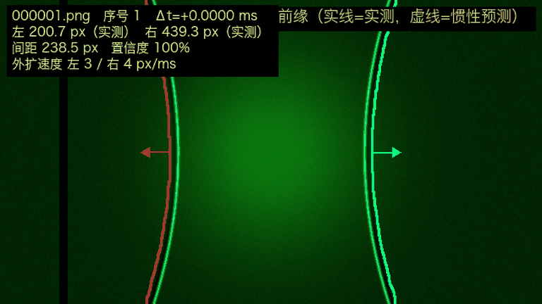

# Shock-Front Tracker

**冲击波前缘跟踪器** · Occlusion-aware tracking of explosion shock-wave fronts

[](#requirements)
[](LICENSE)
[](#requirements)
[](#requirements)
[](https://github.com/masanli1/shock-front-tracker/actions)

SFT extracts the **outermost shock-wave front** from high-speed image sequences of
explosions. It does **not** segment the central fireball, and it does **not** draw
an ellipse around the explosion. When the front is hidden behind a support column,
a trusted-shape + constant-velocity inertia model coasts the curve forward and
labels the frame as `inertia`.



*Synthetic demo: the red/cyan curves are the left/right front; solid = measured,
dashed = inertial prediction. No ellipse, no filled explosion region.*

## Why this exists

Most edge detectors applied to explosion images lock onto the bright fireball
boundary. That boundary is not the shock front: it is the outer luminous edge of
the fireball, and it can sit tens of pixels inside the actual front. SFT scans
**from the image border inward**, so the first coherent front it meets is the
outermost one, not the explosion region.

## Features

- Row-wise outermost scan from the left/right image border
- Static-structure suppression for columns, crossbars and vignetting
- Thin bright-edge criterion + moving-arc saliency criterion
- Robust global motion fit `m(t) = a t + b`
- Occlusion-aware **inertial shape coasting**: the last trusted curve is
  translated rigidly, so curvature does not change during occlusion
- Per-frame `measured` / `inertia` labels
- Metrics CSV, JSON summary, overlays, contact sheet, curves, GIF
- NumPy + Pillow only; no OpenCV, no SciPy

## Requirements

- Python 3.9+
- NumPy >= 1.24
- Pillow >= 9.0

## Install

```bash
pip install shock-front-tracker
```

From source:

```bash
git clone https://github.com/masanli1/shock-front-tracker.git
cd shock-front-tracker
pip install -e .
```

## Quick start

```bash
shockfront track \
    --input /path/to/frames \
    --output results \
    --fps 75000
```

The input folder may contain `.jpg`, `.jpeg`, `.png`, `.bmp`, `.tif`, `.tiff`.
Frames are sorted by filename.

### Try the synthetic demo

No experimental data is required:

```bash
python examples/synthetic_demo.py
```

This generates a synthetic sequence, runs the tracker, and refreshes
`docs/assets/demo.gif`. To run the pipeline manually on the synthetic frames:

```bash
python examples/make_synthetic.py --output examples/synthetic --frames 16
shockfront track --input examples/synthetic --output examples/synthetic_results \
    --fps 1000 --bright-threshold 100 --sal-threshold 5 \
    --bar-clearance 15 --min-measured-rows 40
```

## Outputs

```text
results/
├── frames/
│   ├── 000001_front.png
│   └── ...
├── metrics.csv
├── summary.json
├── curves.png
├── contact_sheet.png
├── preview.gif
└── README.md
```

`metrics.csv` contains one row per frame:

| Column | Meaning |
|---|---|
| `frame`, `time_ms` | frame index / relative time |
| `left_x_px`, `right_x_px` | front position at mid-height |
| `width_px` | distance between left and right front |
| `left_source`, `right_source` | `measured`, `inertia`, or `none` |
| `left_speed_px_ms`, `right_speed_px_ms` | outward speed |
| `confidence` | fraction of valid rows |

`summary.json` stores the configuration, fitted slopes, and visible-frame counts.

## Method

1. Crop the header and keep the green channel.
2. High-pass response `H_t = |G_t − G_t * K_sigma|`.
3. Static response `S = Percentile_20({H_t})` across frames.
4. Saliency `A_t = H_t − S`.
5. For each row, scan inward from the image border:
   - accept a thin bright run with a dark gap behind it, or
   - accept a run of `r` consecutive salient pixels.
6. Clean the track: median outlier removal, short-gap interpolation, smoothing.
7. Fit a robust global line `m(t) = a t + b`.
8. Frames close to the line are `measured`; others are occluded/weak.
9. For occluded frames, freeze the most-curved trusted curve and translate it
   rigidly: `x_t(y) = x_ref(y) + [m(t) − m(t_ref)]`.
10. Update the reference shape slowly only when the front is far from columns
    and has been measured for several consecutive frames.

Full algorithm: [docs/algorithm.md](docs/algorithm.md).

## Accuracy and limits

- In visible, high-contrast regions, repeated positions agree within about
  **1–3 px** on the bundled synthetic demo and **2–5 px** on experimental data.
- `inertia` frames are **predictions**, not measurements. Do not use them for
  acceleration estimates without reporting the uncertainty.
- The early front can coincide with the fireball edge. If the physical
  distinction between shock and flame matters, validate with schlieren/shadow
  imaging or pressure sensors.
- Absolute accuracy depends on pixel calibration and on how the edge is defined
  (bright-line centre, dark-gap boundary, maximum gradient).
- Near the image border (`x < 10 px` or `x > W − 10 px`) the scan window is
  truncated and the uncertainty grows.

## Parameters

See [docs/parameters.md](docs/parameters.md). The most important ones:

| Option | Default | Effect |
|---|---|---|
| `--hp-sigma` | 6.0 | high-pass scale |
| `--static-percentile` | 20 | static-structure suppression |
| `--bright-threshold` | 80 | early thin bright edge |
| `--sal-threshold` | 8 | late low-contrast arc |
| `--bar-clearance` | 20 | freeze shape near columns |
| `--inertia-alpha` | 0.2 | shape update gain away from occlusion |
| `--shape-smooth-y` | 9 | smoothing along the curve |
| `--fit-tolerance` | 12 | measured/inertia classification |

## Citation

If you use this software in academic work, please cite it. See
[CITATION.cff](CITATION.cff).

```bibtex
@software{shockfront2025,
  title  = {Shock-Front Tracker: Occlusion-aware tracking of explosion shock-wave fronts},
  author = {masanli1},
  year   = {2025},
  url    = {https://github.com/masanli1/shock-front-tracker}
}
```

## Contributing

Issues and pull requests are welcome. See [CONTRIBUTING.md](CONTRIBUTING.md)
and [CODE_OF_CONDUCT.md](CODE_OF_CONDUCT.md).

## License

MIT. See [LICENSE](LICENSE).

## Project links

- Repository: https://github.com/masanli1/shock-front-tracker
- Issues: https://github.com/masanli1/shock-front-tracker/issues

## Acknowledgements

The algorithm was developed for high-speed imaging of explosions with static
support columns. The synthetic demo is generated procedurally and contains no
experimental data.
