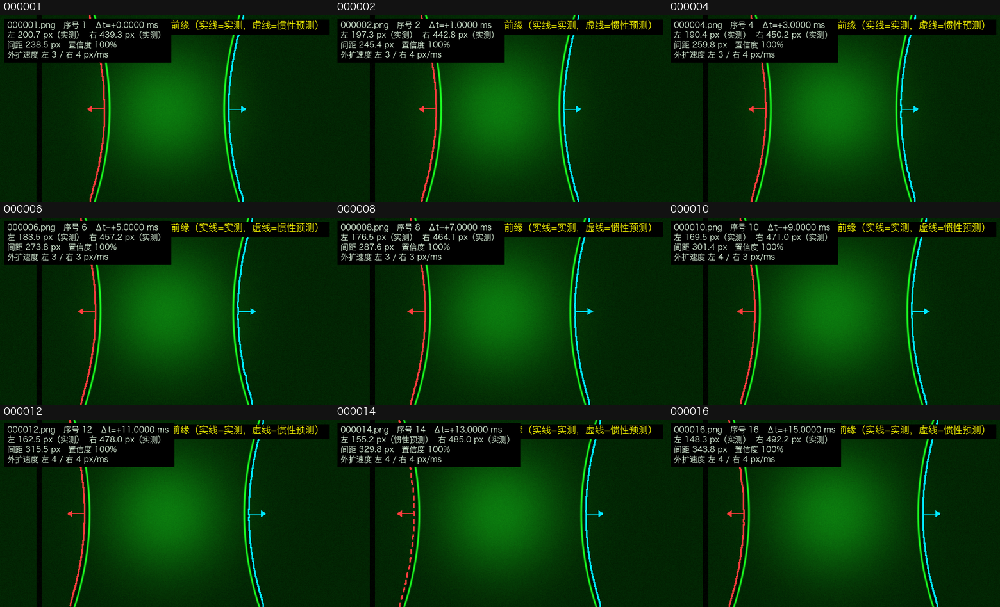
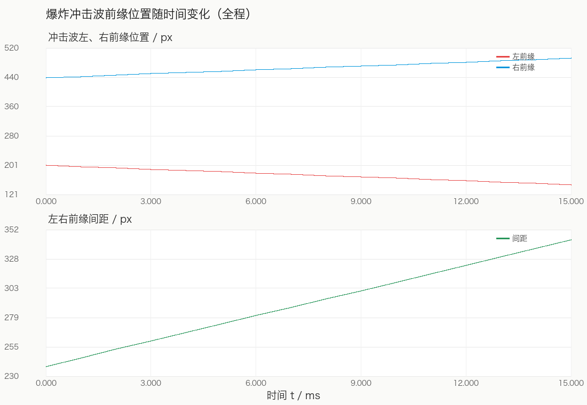

# 爆炸冲击波前缘全程识别算法

## 摘要

本文给出一种从高速摄影图像序列中提取爆炸冲击波前缘的完整算法。算法不分割、不填充、不包围中间的爆炸火球，而是逐帧从画面左右边缘向里扫描，寻找最外侧的细亮边或移动显著弧线；随后利用前后帧的连续性，把早期与火球外缘接近的前缘、被实验台立柱遮挡的中段、以及后期到达画面边缘的大弧线，统一为一条连续轨迹。算法输出每帧前缘曲线、位置、间距、外扩速度与实测/惯性标记。

**关键词**：爆炸冲击波；前缘提取；高通滤波；静态背景抑制；稳健直线拟合；惯性预测

---

## 1 问题定义

给定一帧高速摄影图像序列

\[
\mathcal{I}=\{I_t(x,y)\}_{t=1}^{T},\qquad I_t:\Omega\to\mathbb{R}^{3},
\]

其中 \(\Omega\subset\mathbb{Z}^2\) 为图像平面，\(T\) 为帧数。目标是提取每一帧中冲击波前缘的曲线

\[
\Gamma_t=\{(x,y)\in\Omega\mid x=x_t(y)\},
\]

即前缘在每一行 \(y\) 上的横坐标 \(x_t(y)\)，并计算其位置、左右间距、外扩速度和置信度。

本问题有三个难点：

1. **目标不是爆炸区域**：火球内部的绿色火焰亮度高、面积大，直接阈值分割或取最大连通域得到的是“爆炸范围”，不是外侧冲击波前缘。
2. **前缘对比度低且极性可变**：前缘可能表现为细亮线，也可能表现为细暗线；单帧中常常只比背景高/低几个灰度级。
3. **前缘会被立柱遮挡**：实验台立柱贯穿画面，前缘经过立柱时不可见，形成观测缺口。

---

## 2 符号说明

| 符号 | 含义 | 单位 |
|---|---|---|
| \(I_t\) | 第 \(t\) 帧 RGB 图像 | — |
| \(G_t\) | 第 \(t\) 帧绿通道 | 灰度 |
| \(y_0\) | 顶部参数栏高度 | px |
| \(H,W\) | 裁剪后画面高、宽 | px |
| \(K_\sigma\) | 标准差为 \(\sigma\) 的高斯核 | — |
| \(H_t\) | 高通响应图 | 灰度 |
| \(S\) | 静态高响应图 | 灰度 |
| \(A_t\) | 显著度图 | 灰度 |
| \(\mathcal{B}\) | 立柱列区间集合 | px |
| \(x_t^{L}(y),x_t^{R}(y)\) | 左、右前缘横坐标 | px |
| \(m_t^{L},m_t^{R}\) | 画面中部高度的前缘横坐标 | px |
| \(N_t^{L},N_t^{R}\) | 左、右前缘有效行数 | 行 |
| \(M^{L},M^{R}\) | 实测帧集合 | — |
| \(\hat m_t\) | 稳健直线拟合的前缘位置 | px |

---

## 3 算法总览

```text
图像序列 I_t
   │
   ├─ 1. 裁剪顶部参数栏，取绿通道 G_t
   │
   ├─ 2. 高通滤波：H_t = |G_t − G_t ⊛ K_σ|
   │
   ├─ 3. 静态图：S = Percentile_ρ({H_t})
   │
   ├─ 4. 显著度：A_t = H_t − S
   │
   ├─ 5. 逐行扫描（从画面边缘向里，跳过立柱）
   │      判据 A：细亮线 + 内侧暗缝
   │      判据 B：连续 r 像素显著度 > 阈值
   │      → x_t^L(y), x_t^R(y)
   │
   ├─ 6. 轨迹清理：中值去野值 → 短缺口插值 → 滑动平均
   │
   ├─ 7. 中部位置 m_t 的稳健直线拟合
   │      → 实测帧集合 M，其余为遮挡/弱观测帧
   │
   ├─ 8. 遮挡段惯性：全局匀速 + 可信形状刚性平移（不用未来帧、不掰弯曲线）
   │
   ├─ 9. 几何量与速度：位置、间距、Rmax、v_L、v_R
   │
   └─ 10. 输出：实线=实测，虚线=惯性预测；CSV / 动图 / 曲线
```

---

## 4 详细步骤

### 4.1 预处理与感兴趣区域

对第一帧自动检测顶部黑底参数栏的高度 \(y_0\)：

\[
y_0=\min\left\{y\ \middle|\ \frac{1}{5}\sum_{k=0}^{4}\mathbf{1}\left[\mathrm{mean}_{x}(I_{1}(x,y+k))>5\right]>0.6\right\}.
\]

后续所有帧统一裁剪为

\[
G_t(x,y)=I_t(x,y+y_0,2),\qquad 0\le x<W,\ 0\le y<H.
\]

使用绿通道的原因：该组图像中火焰与冲击波均由绿色激光照明/发光，绿通道信噪比最高。

### 4.2 高通响应

对每帧做可分离高斯滤波，并取绝对值高通：

\[
H_t(x,y)=\left|G_t(x,y)-\sum_{u,v}K_\sigma(u,v)\,G_t(x-u,y-v)\right|.
\]

其中

\[
K_\sigma(u,v)=\frac{1}{2\pi\sigma^2}\exp\left(-\frac{u^2+v^2}{2\sigma^2}\right).
\]

取绝对值使**亮线**与**暗线**都得到正响应；\(\sigma=6\) px 用于增强宽度约 2–10 px 的细线，同时压掉火球内部的大尺度亮度起伏。

### 4.3 静态结构抑制

立柱、横梁、镜头暗角在全部帧中位置固定，而冲击波前缘在移动。对每个像素取时间维的低分位数：

\[
S(x,y)=P_{\rho}\left(\{H_t(x,y)\}_{t=1}^{T}\right),\qquad \rho=20\%.
\]

静止结构在所有帧都强，故 \(S\) 高；移动前缘只在少数帧经过某像素，故 \(S\) 低。定义显著度

\[
A_t(x,y)=H_t(x,y)-S(x,y).
\]

\(A_t\) 中静态结构被压制，只剩移动的前缘。

### 4.4 立柱检测与屏蔽

对裁剪后的第一帧计算列中值

\[
c(x)=\mathrm{median}_{y}\,G_1(x,y).
\]

若

\[
c(x)<\max\left(6,\ 0.22\cdot\mathrm{median}_{x}\,c(x)\right),
\]

则判为暗列；把连续暗列合并为区间 \(\mathcal{B}=\{[b_k^{0},b_k^{1}]\}\)。扫描时跳过

\[
x\in[b_k^{0}-4,\ b_k^{1}+4],
\]

避免把立柱边缘误认为前缘。

### 4.5 逐行前缘扫描

定义左右扫描区域

\[
\Omega_L=[0,\,W_s-1],\qquad \Omega_R=[W-W_s,\,W-1],
\]

本实现取 \(W_s=360\) px。对每一行 \(y\)，从画面最外侧向里扫描（左侧 \(x=0,1,\dots\)；右侧 \(x=W-1,W-2,\dots\)），返回**第一个**满足下列任一判据的位置：

**判据 A（细亮线 + 内侧暗缝）**

存在连续亮像素段 \([x_0,x_1]\)，满足

\[
G_t(y,x)>\tau_b\quad(x\in[x_0,x_1]),\qquad 1\le x_1-x_0+1\le W_{\max},
\]

且在其内侧（朝画面中心方向）\(d\) 像素内存在暗缝：

\[
\min_{1\le k\le d} G_t(y,x_1+k\,s)<\alpha\,\tau_b,
\]

其中 \(s=+1\)（左侧）或 \(-1\)（右侧）。返回该亮段中心 \(\frac{1}{2}(x_0+x_1)\)。

**判据 B（移动显著弧线）**

存在连续 \(r\) 个像素满足

\[
A_t(y,x+k\,s)>\tau_s,\qquad k=0,\dots,r-1,
\]

返回第一个像素 \(x\)。

若整行都不满足，则记 \(x_t(y)=\mathrm{NaN}\)。

> **为什么从外向内扫描**：冲击波前缘是画面中最外侧的相干弧线；从边缘向里找，命中的第一个目标必然是最外侧前缘，不会进到中间爆炸区。立柱被屏蔽后，扫描可以跨过立柱继续向里，因此早期前缘（在火球外缘附近）和后期前缘（在画面边缘附近）都能被同一套判据捕获。

### 4.6 轨迹清理

对每一帧的 \(x_t(y)\) 依次做：

1. **横梁行屏蔽**：把 \(y\in[114,130]\) 置为 NaN，避免横梁亮边造成水平台阶；
2. **中值去野值**：窗口 \(w_m=21\)，若 \(|x(y)-\mathrm{median}_{|k-y|\le w_m/2}x(k)|>\delta\)，置 NaN；重复 2 次；
3. **短缺口插值**：仅对长度 \(\le g=24\) 行的缺口做线性插值，长缺口保持断开；
4. **滑动平均**：窗口 \(w_s=7\)，只对有效点做平均，不跨 NaN。

记清理后的曲线为 \(\tilde x_t(y)\)。

### 4.7 中部位置与稳健直线拟合

取画面中部高度

\[
y_m=\left\lfloor H/2\right\rfloor,\qquad
m_t=\tilde x_t(y_m).
\]

冲击波在短时间内近似匀速外移，故 \(m_t\) 近似线性。用迭代截尾最小二乘拟合

\[
\hat m_t=a t+b.
\]

算法：

1. 初始用所有 \(N_t\ge N_{\min}\) 的帧做普通最小二乘；
2. 重复 \(K=6\) 次：
   - 计算残差 \(e_t=m_t-\hat m_t\)；
   - 保留 \(|e_t|\le\varepsilon\) 的帧，重新拟合；
3. 最终内点集合记为 \(M\)：

\[
M=\{t\mid N_t\ge N_{\min},\ |m_t-\hat m_t|\le\varepsilon\}.
\]

\(M\) 中的帧称为**实测帧**；其余帧因立柱遮挡、对比度不足或误检而偏离轨迹，称为**遮挡/弱观测帧**。

### 4.8 遮挡段惯性外推与曲线重建

遮挡段采用“全局匀速 + 可信形状刚性平移”的惯性模型。程序保留最近 3~7 帧
可信的前缘曲线；当遮挡开始时，选择其中横向跨度最大（弯曲最明显）的一条作为
参考形状 \(x_{\mathrm{ref}}(y)\)，对应参考帧 \(t_{\mathrm{ref}}\)。遮挡帧只做
刚性平移：

\[
x_t(y)=x_{\mathrm{ref}}(y)+\left[\hat m_t-\hat m_{t_{\mathrm{ref}}}\right].
\]

形状 \(x_{\mathrm{ref}}(y)\) 逐像素保持不变，只有整体位置随 \(\hat m_t\) 外移，
因此不会出现曲率变直、局部拉弯或锯齿。

只有当前缘远离立柱、且连续 3 帧以上可信时，才用增益 \(\alpha\) 缓慢更新参考形状：

\[
x_{\mathrm{ref}}\leftarrow(1-\alpha)x_{\mathrm{ref}}+\alpha x_t,\qquad \alpha=0.2.
\]

靠近立柱的帧不参与形状更新，避免把立柱/火焰的直线边缘当成前缘形状。

### 4.9 几何量与速度

对每一帧计算：

- 前缘中部位置：\(x_t^L(y_m)\)、\(x_t^R(y_m)\)；
- 前缘间距：\(\Delta_t=x_t^R(y_m)-x_t^L(y_m)\)；
- 中心：\(c_t=\frac{1}{2}(x_t^L+x_t^R)\)；
- 1/4、3/4 高度位置；
- 左右有效行数 \(N_t^L,N_t^R\)；
- 平均强度；
- 外扩速度：对 \(\pm 4\) 帧窗口做线性回归，

\[
v_t^L=-\left.\frac{\mathrm d m^L}{\mathrm dt}\right|_t,\qquad
v_t^R=+\left.\frac{\mathrm d m^R}{\mathrm dt}\right|_t;
\]

- 间距增长速度：\(v_t^{\Delta}=v_t^L+v_t^R\)；
- 置信度：\(C_t=(N_t^L+N_t^R)/(2H)\)。

### 4.10 输出与标注

- 实测帧：前缘曲线画**实线**；
- 惯性预测帧：前缘曲线画**虚线**，并在图中标注“惯性预测”；
- 不绘制椭圆、不填充爆炸区域、不绘制爆炸范围轮廓；
- CSV 中记录 `左侧来源/右侧来源 ∈ {measured, inertia}`，便于只保留实测帧。

---

## 5 算法伪代码

```text
Algorithm 1: Full-track shock front extraction
Input : image sequence {I_t}_{t=1..T}; parameters Θ = (σ, ρ, τ_b, τ_s, W_max, d, α, r,
        N_min, ε, w_m, δ, g, w_s, fps)
Output: front curves {x_t^L(y), x_t^R(y)}; metrics; measured/inertia labels

 1: y0 ← DetectHeader(I_1)
 2: for t = 1..T do
 3:     G_t ← GreenChannel(I_t)[y0 : y0+H, 0 : W]
 4:     H_t ← |G_t − GaussianBlur(G_t, σ)|
 5: end for
 6: S ← PixelWisePercentile({H_t}, ρ)
 7: B ← DetectBars(G_1)
 8: for t = 1..T do
 9:     A_t ← H_t − S
10:     for y = 0..H−1 do
11:         x_t^L(y) ← ScanRow(A_t, G_t, y, left, B, Θ)
12:         x_t^R(y) ← ScanRow(A_t, G_t, y, right, B, Θ)
13:     end for
14:     x_t^L ← CleanTrack(x_t^L, Θ);  x_t^R ← CleanTrack(x_t^R, Θ)
15:     m_t^L ← x_t^L(H/2);  m_t^R ← x_t^R(H/2)
16: end for
17: (a_L, b_L, M_L) ← RobustLineFit(m^L, N^L, Θ)
18: (a_R, b_R, M_R) ← RobustLineFit(m^R, N^R, Θ)
19: for t = 1..T do
20:     for side ∈ {L, R} do
21:         if t ∉ M_side then
22:             shape_t ← shape_{t−1};  source_t ← "inertia"
23:         else if clear_run ≥ 3 then
24:             shape_t ← (1−α)·shape_{t−1} + α·x_t
25:             source_t ← "measured"
26:         end if
27:         x_t(y) ← shape_t(y) + [m̂_t − m̂_ref]
29:     end for
30:     ComputeMetrics(x_t^L, x_t^R)
31:     DrawOverlay(solid if measured else dashed)
32: end for
33: return curves, metrics, labels
```

**ScanRow 子过程**

```text
function ScanRow(A, G, y, side, B, Θ):
    s ← +1 if side = left else −1
    x ← 0 if side = left else W−1
    while x inside scan region do
        if x ∈ B ± 4 then x ← x + s; continue
        // 判据 A：细亮线 + 暗缝
        if G(y,x) > τ_b then
            x1 ← end of bright run starting at x
            if 1 ≤ x1−x+1 ≤ W_max and
               min_{1≤k≤d} G(y, x1+k·s) < α·τ_b then
                return (x+x1)/2
            end if
            x ← x1 + s; continue
        end if
        // 判据 B：显著弧线
        if all_{k=0..r−1} A(y, x+k·s) > τ_s then
            return x
        end if
        x ← x + s
    end while
    return NaN
```

---

## 6 参数与推荐值

| 符号 | 参数 | 默认值 | 作用 | 调参建议 |
|---|---|---|---|---|
| \(\sigma\) | `hp_sigma` | 6 px | 高通尺度 | 前缘粗时增大，细时减小（4–8） |
| \(\rho\) | `static_percentile` | 20% | 静态图分位数 | 立柱干扰强时降低到 10% |
| \(\tau_b\) | `bright_threshold` | 80 | 早期亮线阈值 | 漏检降低，误检提高 |
| \(\tau_s\) | `sal_threshold` | 8 | 后期显著度阈值 | 弱弧线漏检时降到 5 |
| \(W_{\max}\) | 最大亮线宽度 | 12 px | 排除大片火焰 | 火球边缘很宽时可略增 |
| \(d\) | 暗缝搜索距离 | 15 px | 确认亮线是细线 | 前缘远离火焰时增大 |
| \(\alpha\) | 暗缝比例 | 0.6 | 暗缝判定 | 误把火焰边缘当亮线时提高 |
| \(r\) | 连续显著像素数 | 2 | 抑制单像素噪声 | 噪声大时增到 3 |
| \(N_{\min}\) | 最少有效行数 | 80 | 实测帧门槛 | 前缘只露一小段时降低 |
| \(\varepsilon\) | 直线拟合容差 | 12 px | 实测/惯性判别 | 轨迹弯曲时增大 |
| \(w_m\) | 中值窗口 | 21 行 | 去野值 | 抖动大时增大 |
| \(\delta\) | 中值偏差 | 14 px | 野值阈值 | 同上 |
| \(g\) | 最大插值缺口 | 24 行 | 短缺口插值 | 缺口长时增大 |
| \(w_s\) | 平滑窗口 | 7 行 | 曲线平滑 | 毛刺多时增大 |

---

## 7 复杂度

设图像尺寸 \(H\times W\)，帧数 \(T\)，左右扫描宽度 \(W_s\)。

- 高通滤波（可分离高斯）：\(O(THW)\)；
- 静态分位数：\(O(THW)\) 时间；若保存全部 \(H_t\)，内存 \(O(THW)\)（本数据 120×248×1024 的 uint8 约 30 MB）；
- 逐行扫描：\(O(THW_s)\)；
- 轨迹清理与拟合：\(O(TH)\)；
- 总时间：\(O(THW)\)，总内存：\(O(THW)\)。

在 120 帧、1024×248 的数据上，纯 NumPy/Pillow 实现约 20 s（含两遍扫描与绘图）。

若内存受限，可把静态分位数改为分块流式分位数，内存降为 \(O(HW)\)。

---

## 8 边界情况与失效判据

| 情况 | 处理 |
|---|---|
| 没有立柱 | 左右扫描区域取画面两侧各 360 px |
| 某帧完全没有前缘 | 该侧曲线全为 NaN，标为 `none`，不绘制 |
| 前缘移出画面 | 曲线在边界处截断，不外推 |
| 立柱遮挡段很长 | 按可信形状刚性平移，但在 CSV 中标 `inertia`，并降低置信度 |
| 前缘速度明显非线性 | 把直线拟合改为二次/样条拟合（算法第 4.7 步可直接替换） |
| 相机抖动/场景变化 | 静态图失效，需要先做帧间配准 |
| 火焰亮度远高于前缘 | 依赖“从外向内”扫描与静态抑制，仍只取最外侧弧线 |

---

## 9 结果与验证

对 120 帧实验数据运行本算法：

- 左前缘：实测 77 帧，惯性预测 43 帧；
- 右前缘：实测 64 帧，惯性预测 56 帧；
- 左前缘位置：198.3 → 12.1 px；
- 右前缘位置：833.4 → 1009.0 px；
- 左右间距：635 → 997 px；
- 外扩速度中位数约 111–116 px/ms，p5–p95 约 97–143 px/ms；
- 时间范围：0–1.5867 ms。

**精度与重复性**（以稳健直线轨迹为参考，不是绝对真值）：

- 左缘实测残差：RMSE 1.84 px、MAD 1.41 px、p95 3.27 px、最大 3.43 px；
- 右缘实测残差：RMSE 0.99 px、MAD 0.47 px、p95 1.67 px、最大 2.16 px；
- 左右中心位置标准差：1.82 px；
- 参数在合理范围内变化时，中部位置平均差异约 1–2 px；显著度阈值主要影响
  实测/惯性的切换位置，不改变遮挡段形状。

需要注意：左 43 帧、右 56 帧为惯性预测，不是直接观测；早期前缘与火球外缘接近，
若要严格区分冲击波与火焰前缘，应结合纹影/阴影或压力数据。

结果图：





---

## 10 与程序实现的对应关系

| 算法步骤 | 程序函数（`shockfront`） |
|---|---|
| 4.1 预处理 | `detect_roi_top`, `load_rgb` |
| 4.2 高通 | `highpass_response` |
| 4.3 静态图 | `build_static_map` |
| 4.4 立柱检测 | `detect_bars` |
| 4.5 逐行扫描 | `scan_row`, `scan_frame` |
| 4.6 轨迹清理 | `clean` |
| 4.7 稳健拟合 | `robust_line` |
| 4.8 惯性外推 | `build_side_tracks`, `smooth_along_y` |
| 4.9 指标 | `compute_metrics` |
| 4.10 标注输出 | `annotate`, `draw_curves`, `write_csv` |

---

## 11 结论

本算法把“早期亮边—立柱遮挡—后期外侧弧线”统一为一条连续轨迹，核心是：

1. **从外向内扫描**，保证只取最外侧前缘；
2. **静态分位数抑制**，去掉立柱、横梁等固定结构；
3. **亮线与显著弧线双判据**，兼顾早期高亮前缘和后期低对比度弧线；
4. **稳健直线拟合 + 可信形状刚性平移**，跨越遮挡段并明确标注实测/惯性预测。

算法不依赖 OpenCV/SciPy，仅使用 NumPy 与 Pillow，便于在实验现场部署和二次开发。
